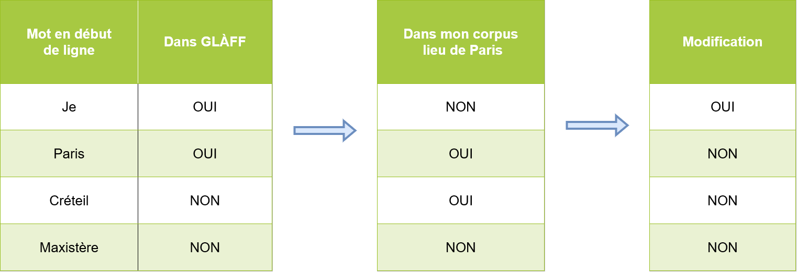
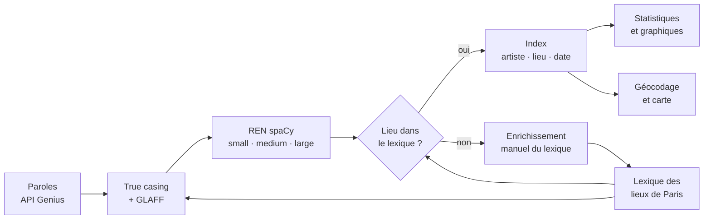
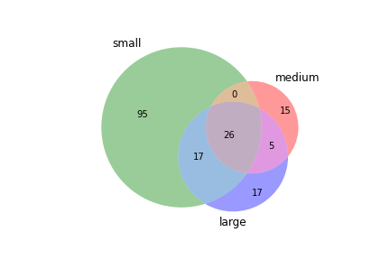
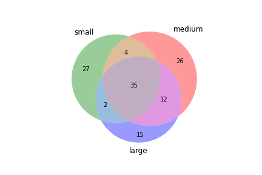
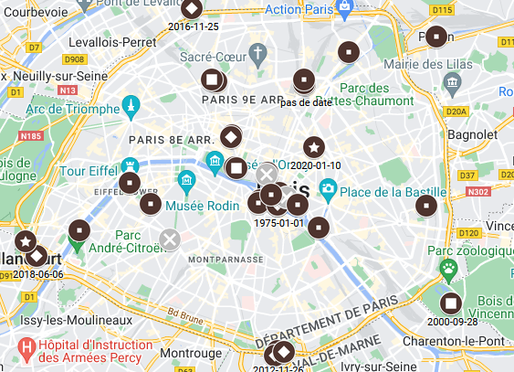
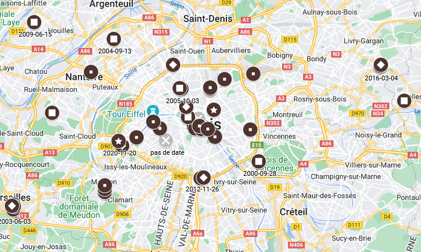

# Les lieux de Paris dans la chanson francophone

**Observer automatiquement l'évocation des lieux de Paris dans la chanson francophone : adaptabilité de la reconnaissance d'entités nommées et *true casing*.**

Mémoire de Master 1 *Langue et Informatique* — Sorbonne Université, Faculté des Lettres (2022)
Tiago André De Carvalho Bene


📄 **Le mémoire complet : [`docs/memoire.pdf`](docs/memoire.pdf)**

---

## Sommaire

- [Le sujet en bref](#le-sujet-en-bref)
- [Principaux résultats](#principaux-résultats)
- [Organisation du dépôt](#organisation-du-dépôt)
- [Installation](#installation)
- [Utilisation](#utilisation)
- [Les données](#les-données)
- [Ce qui a changé depuis la version de 2022](#ce-qui-a-changé-depuis-la-version-de-2022)
- [Limites connues](#limites-connues)
- [Droits et licences](#droits-et-licences)

---

## Le sujet en bref

Paris est le lieu le plus cité de la chanson française. Ce travail cherche à **repérer automatiquement les lieux parisiens** (rues, places, monuments, quartiers, communes de banlieue…) **dans les paroles de chansons francophones**, puis à observer comment ces mentions évoluent dans le temps.

L'hypothèse de départ : la transformation de Paris en « ville globale » et l'éloignement des classes populaires vers des banlieues de plus en plus lointaines devraient se refléter dans les lieux évoqués par les chanteurs — des cafés et des rues du Paris populaire chez les chanteurs réalistes d'avant-guerre, vers des lieux plus emblématiques, puis vers la banlieue chez les rappeurs.

Les objectifs :

1. **détecter** les noms de lieux avec la reconnaissance d'entités nommées (REN) de [spaCy](https://spacy.io/), en comparant ses trois modèles français (*small*, *medium*, *large*) ;
2. **améliorer** cette détection par un pré-traitement adapté aux paroles (*true casing*) ;
3. **croiser** les entités trouvées avec un lexique de 8 507 lieux de Paris et d'Île-de-France ;
4. **cartographier** les lieux cités selon la date de sortie des chansons.

### Pourquoi les paroles posent problème

Dans des paroles, **chaque ligne commence par une majuscule**. Pour spaCy, une majuscule en milieu de « phrase » est un fort indice d'entité nommée : sur le seul échantillon de Jacques Dutronc, le modèle *small* étiquette comme lieux des mots comme « Ministère », « Minimum » ou « Hâtez ».

Le pré-traitement proposé remet en minuscule le premier mot de chaque ligne **s'il existe en minuscule dans le [GLAFF](http://redac.univ-tlse2.fr/lexiques/glaff.html)** (un lexique de plus d'un million de formes du français) **et qu'il n'est pas un lieu de Paris connu** :

<p align="center"></p>

Un espace est ensuite ajouté autour de chaque retour à la ligne pour que spaCy sépare bien le dernier mot d'une ligne du premier mot de la suivante.



---

## Principaux résultats

**Le pré-traitement réduit nettement les fausses détections.** Sur l'échantillon de Jacques Dutronc, le modèle *small* passe de **138 à 68** lieux distincts détectés, et le nombre de lieux sur lesquels les trois modèles s'accordent passe de 26 à 35.

| Avant pré-traitement | Après pré-traitement |
|:---:|:---:|
|  |  |

**Le *true casing* est fiable** : environ 1 260 débuts de ligne mis en minuscule à juste titre pour seulement 2 erreurs (précision ≈ 99,8 %, rappel ≈ 80 %, F-mesure ≈ 89 %).

**Évaluation de spaCy *large*** sur trois chansons annotées à la main (*L'Aventurier*, *Paris s'éveille*, *J'aime les filles*) :

| | Précision | Rappel | F-mesure |
|---|---:|---:|---:|
| Micro-moyenne (occurrences) | 63,79 % | 77,08 % | 69,81 % |
| Macro-moyenne (lieux distincts) | 63,16 % | 68,57 % | 65,75 % |

**Un léger glissement vers la banlieue.** Sur le corpus complet, les lieux de banlieue cités (d'Évry au sud jusqu'à Pontoise au nord-ouest) apparaissent surtout dans des chansons sorties entre 2001 et 2019, en particulier entre 2001 et 2010 ; avant 2000, on n'en trouve que quelques-uns, vers Versailles et Nanterre.

| Paris intra-muros | Paris et sa banlieue |
|:---:|:---:|
|  |  |

Le détail (proportions par chanson, listes d'entités, discussion linguistique) est dans le [mémoire](docs/memoire.pdf), chapitre 4.

---

## Organisation du dépôt

```
.
├── README.md
├── requirements.txt
├── lieuxparis/                 ← le code (package Python)
│   ├── __main__.py             interface en ligne de commande
│   ├── config.py               chemins et constantes
│   ├── corpus.py               lecture des corpus, statistiques
│   ├── lexique.py              lexique des lieux de Paris, catégories
│   ├── ner.py                  REN avec spaCy, comparaison des modèles
│   ├── truecasing.py           pré-traitement (casse + espaces)
│   ├── proportions.py          proportions d'EN / de majuscules par chanson
│   ├── analyse.py              index artistes ↔ lieux ↔ années
│   ├── evaluation.py           précision, rappel, F-mesure (micro / macro)
│   ├── visualisation.py        Venn, histogrammes, matrices de confusion
│   ├── carte.py                géocodage et carte
│   └── enrichissement.py       enrichissement manuel du lexique
├── data/                       ← données d'entrée
│   ├── corpus/                 échantillon brut (Jacques Dutronc, format Genius)
│   ├── corpus_pretraite/       corpus après true casing (complet, Dutronc, 113)
│   ├── lexique_lieux_paris/    31 listes de lieux (rues, portes, églises, communes…)
│   └── glaff/                  vocabulaire du GLAFF avec fréquences
├── resultats/                  ← résultats obtenus pour le mémoire
│   ├── entites/                lieux détectés par les 3 modèles, avant / après pré-traitement
│   ├── proportions/            proportions par chanson (échantillon, Dutronc, 113…)
│   ├── analyse/                dictionnaires artistes ↔ lieux, longueurs des chansons
│   ├── figures/                diagrammes de Venn, matrices, histogrammes top 5
│   └── carte/                  lieux géolocalisés (CSV) et cache de géocodage
└── docs/
    ├── memoire.pdf             le mémoire
    └── figures/                cartes et illustrations du mémoire
```

---

## Installation

Python 3.9 ou plus récent.

```bash
git clone https://github.com/Tiiiagooo/Memoire.git
cd Memoire

python -m venv .venv
source .venv/bin/activate          # Windows : .venv\Scripts\activate

pip install -r requirements.txt

# Modèles français de spaCy (le modèle large pèse ~550 Mo)
python -m spacy download fr_core_news_sm
python -m spacy download fr_core_news_md
python -m spacy download fr_core_news_lg
```

---

## Utilisation

Tout passe par une seule commande :

```bash
python -m lieuxparis --help
python -m lieuxparis <commande> --help
```

| Commande | Rôle |
|---|---|
| `stats` | statistiques sur un corpus |
| `lexique` | taille et catégories du lexique des lieux |
| `pretraiter` | *true casing* + espaces autour des retours à la ligne |
| `ner` | détection des lieux avec spaCy (small / medium / large) |
| `comparer` | lieux communs / propres à chaque modèle, diagramme de Venn |
| `proportions` | proportions d'entités et de majuscules par chanson, tableau LaTeX |
| `evaluer` | précision / rappel / F-mesure face à une annotation manuelle |
| `analyser` | index artistes ↔ lieux ↔ années (fichiers JSON) |
| `graphique` | histogramme « top 5 » pour un lieu, un artiste ou une année |
| `chercher` | dans quelles chansons un lieu est-il cité ? |
| `enrichir` | compléter le lexique à la main |
| `carte` | géolocaliser les lieux (CSV) et produire une carte HTML |

### Reproduire l'étude sur l'échantillon Jacques Dutronc

```bash
# 1. Quelques chiffres sur l'échantillon (92 chansons, dont 42 avec paroles)
python -m lieuxparis stats --corpus data/corpus/echantillon_jacques_dutronc.json

# 2. REN brute avec les trois modèles, puis comparaison
python -m lieuxparis ner --corpus data/corpus/echantillon_jacques_dutronc.json \
    --sortie resultats/entites/dutronc_brut.json
python -m lieuxparis comparer --entites resultats/entites/dutronc_brut.json \
    --venn resultats/figures/venn_dutronc_brut.png

# 3. Pré-traitement (true casing) et matrice de confusion
python -m lieuxparis pretraiter --corpus data/corpus/echantillon_jacques_dutronc.json \
    --sortie data/corpus_pretraite/dutronc.json \
    --matrice resultats/figures/matrice_truecasing_dutronc.png

# 4. REN sur le texte pré-traité : bien moins de fausses détections
python -m lieuxparis ner --corpus data/corpus_pretraite/dutronc.json \
    --sortie resultats/entites/dutronc_pretraite.json
python -m lieuxparis comparer --entites resultats/entites/dutronc_pretraite.json \
    --venn resultats/figures/venn_dutronc_pretraite.png

# 5. Proportions par chanson, avec un tableau LaTeX prêt pour Overleaf
python -m lieuxparis proportions --corpus data/corpus_pretraite/dutronc.json \
    --modele large --latex proportions_dutronc.tex
```

### Explorer le corpus complet

Par défaut, ces commandes partent des lieux détectés par le modèle *large* sur le corpus complet (`resultats/entites/avant_pretraitement.json`), filtrés par le lexique, et des dates du corpus pré-traité :

```bash
python -m lieuxparis analyser                         # écrit les index dans resultats/analyse/
python -m lieuxparis graphique --artiste _113         # les 5 lieux les plus cités par 113
python -m lieuxparis graphique --lieu "Créteil"       # les artistes qui citent Créteil
python -m lieuxparis graphique --annee 2010           # les lieux les plus cités en 2010
python -m lieuxparis chercher "Place de Clichy"       # les chansons qui citent ce lieu
```

### Carte

```bash
python -m lieuxparis carte --html resultats/carte/carte.html
```

Les lieux sont géocodés avec [Nominatim](https://nominatim.org/) (OpenStreetMap), à raison d'une requête par seconde. Les résultats sont mis en cache dans `resultats/carte/cache_geocodage.json` : une exécution interrompue reprend là où elle s'était arrêtée. Le CSV produit (séparateur `;`) s'importe directement dans Google My Maps ou [uMap](https://umap.openstreetmap.fr/) ; l'option `--html` génère en plus une carte interactive colorée par période (1940-2000, 2001-2010, 2011-2019, 2020+).

### Compléter le lexique

```bash
python -m lieuxparis enrichir --entites resultats/entites/apres_pretraitement.json
```

Pour chaque lieu détecté par spaCy mais absent du lexique, le programme demande s'il s'agit d'un lieu de Paris et s'il en existe d'autres noms (« BNF » pour « Bibliothèque nationale de France », par exemple). Les réponses sont enregistrées dans `data/ajouts_lexique.json` et prises en compte automatiquement par toutes les autres commandes.

### Utiliser le code depuis Python

```python
from lieuxparis.corpus import charger_corpus
from lieuxparis.lexique import charger_lexique
from lieuxparis.ner import lieux_detectes

lexique = charger_lexique()
chansons = charger_corpus("data/corpus_pretraite/corpus_complet.json", artistes=["_113"])

for chanson in chansons[:5]:
    if chanson.a_des_paroles:
        lieux = lieux_detectes(chanson.paroles, "large")
        print(chanson.titre, "→", [l for l in lieux if l in lexique])
```

---

## Les données

### Corpus de paroles

Les paroles ont été récupérées avec l'[API Genius](https://docs.genius.com/), qui ne fournit pas toujours les paroles ni la date de sortie.

| Fichier | Contenu |
|---|---|
| `data/corpus/echantillon_jacques_dutronc.json` | 92 chansons de Jacques Dutronc (42 avec paroles, 2 datées), format brut Genius |
| `data/corpus_pretraite/corpus_complet.json` | 34 819 chansons de 974 artistes (17 819 avec paroles, 13 867 datées), après *true casing* |
| `data/corpus_pretraite/jacques_dutronc.json`, `113.json` | sous-corpus pré-traités utilisés dans le mémoire |

Format brut (Genius) :

```json
{ "<artiste>": [ { "full_title": "…", "release_date": "1968-01-01", "lyrics": "…",
                   "album": { "artist": { "name": "…" } } } ] }
```

Format pré-traité :

```json
{ "<artiste>": [ { "Titre_chanson": "…", "Auteur": "…", "Date": "1968-01-01", "lyrics": ["…"] } ] }
```

### Lexique des lieux de Paris

`data/lexique_lieux_paris/` contient **31 listes** de lieux classés par catégorie, soit **8 507 noms distincts** : 5 840 voies, 1 309 communes d'Île-de-France, 351 édifices religieux, 179 quartiers, les portes, barrières, buttes, fontaines, moulins, musées, etc. La commande `python -m lieuxparis lexique` en donne le détail. Les comparaisons avec le lexique ignorent la casse (« Place de Clichy » = « place de Clichy »).

### GLAFF

`data/glaff/frequences_glaff.json` associe chacune des 1 082 688 formes du GLAFF 1.2.2 à la somme de ses fréquences. Il a été construit à partir du fichier brut `glaff-1.2.2.txt` (non inclus, trop volumineux) avec `lieuxparis.truecasing.frequences_glaff()`.

### Résultats

| Dossier | Contenu |
|---|---|
| `resultats/entites/avant_pretraitement.json` | lieux détectés par les 3 modèles sur le corpus brut complet |
| `resultats/entites/apres_pretraitement.json` | idem sur les textes pré-traités de Jacques Dutronc et 113 |
| `resultats/proportions/` | proportions par chanson (lieux, toutes EN, lexique, majuscules) |
| `resultats/analyse/` | dictionnaires artistes → lieux, lieux → artistes, longueur des chansons |
| `resultats/figures/` | diagrammes de Venn, matrices de confusion, histogrammes « top 5 » |
| `resultats/carte/lieux_geolocalises_2022.csv` | extrait géolocalisé produit en 2022 (voir [limites](#limites-connues)) |

Format de `resultats/entites/*.json` :

```json
{ "<artiste>": { "<titre>": { "small": ["Paris", "…"], "medium": ["…"], "large": ["…"] } } }
```

---

## Ce qui a changé depuis la version de 2022

Le code d'origine (un notebook de 2 700 lignes exporté en script) a été réécrit en modules, avec une interface en ligne de commande. La méthode est la même ; plusieurs erreurs ont été corrigées au passage :

- **Intersection des trois modèles** : une mauvaise variable était ajoutée à la liste (`lieux2` au lieu de `lieux3`).
- **Exclusion des lieux trop généraux sur la carte** : le test `lieu != stop_lieu` comparait une chaîne à une liste et n'excluait donc jamais « Paris », « Seine »… — d'où les 271 points sur 343 placés sur Notre-Dame dans l'ancien CSV.
- **Proportion de majuscules** : la valeur était enregistrée sous le titre de la chanson précédente.
- **True casing** : la ligne était reconstruite par `" ".join(...)`, ce qui insérait des espaces parasites (« petit , petit », « l' index ») ; seul le premier mot est maintenant remplacé.
- **Matrice de confusion** : les cases *FP* et *VN* étaient inversées dans le graphique, et la « *accuracy* » calculée était en fait une précision.
- **Évaluation** : la position des entités prédites mélangeait indices de tokens et de caractères.
- **Géocodage** : requêtes espacées d'une seconde (conditions d'usage de Nominatim), cache, et les erreurs réseau ne sont plus enregistrées comme « lieu introuvable ».
- **Données** : le lexique était présent en double (`lieux_paris/` et `lieux_paris/lieux_paris/`) avec des fichiers de conflit de fusion (`Puits_de_Paris_BASE_1344.json`…) ; `all_entites2.json` contenait deux objets JSON collés et n'était plus lisible. Tout a été dédupliqué ou réparé, et les noms de fichiers n'ont plus d'espaces ni d'accents.

La version d'origine reste disponible sur la branche [`version-originale-2022`](https://github.com/Tiiiagooo/Memoire/tree/version-originale-2022).

---

## Limites connues

- **Corpus brut complet absent** : seul l'échantillon Dutronc est fourni au format brut ; le corpus complet n'est disponible que pré-traité. Les résultats de `resultats/entites/avant_pretraitement.json` ont été calculés sur ce corpus brut.
- **Fichier d'annotation manquant** : l'évaluation du mémoire reposait sur trois chansons annotées à la main (`evaluation_tiago1.xlsx.json`), qui ne figure pas dans le dépôt. La commande `evaluer` attend ce format :
  ```json
  [ { "text": "…paroles…", "entities": [[debut, fin, "Place de Clichy"], …] } ]
  ```
- **Carte** : `lieux_geolocalises_2022.csv` est un extrait partiel (9 lieux distincts) ; les cartes du mémoire ont été réalisées dans Google My Maps. Relancer `python -m lieuxparis carte` régénère un CSV complet.
- **Désambiguïsation** : un même lieu peut avoir plusieurs noms (« BNF », « QG »…), et certains mots du lexique sont ambigus (« Gare », « Cité », « Chapelle »). L'enrichissement manuel n'en traite qu'une partie.
- **Versions de spaCy** : les chiffres du mémoire ont été obtenus avec spaCy 3.3 ; les modèles plus récents donnent des résultats légèrement différents.

---

## Droits et licences

- **Paroles de chansons** : © leurs auteurs et ayants droit, récupérées via l'API Genius (© Genius Media Group Inc.). Elles sont utilisées ici à des fins de recherche, dans le cadre de l'exception de fouille de textes et de données prévue par le droit français (art. L122-5-3 du Code de la propriété intellectuelle). Elles ne doivent pas être réutilisées à d'autres fins.
- **GLAFF** : Sajous, F., Hathout, N. & Calderone, B. (2013). *GLÀFF, un Gros Lexique À tout Faire du Français*. Actes de TALN 2013. Diffusé sous licence [Creative Commons BY-SA](https://creativecommons.org/licenses/by-sa/3.0/).
- **spaCy** : Honnibal, M. & Montani, I. (2017), licence MIT.

### Citer ce travail

```
De Carvalho Bene, T. A. (2022). Observer automatiquement l'évocation des lieux de Paris
dans la chanson francophone : adaptabilité de la reconnaissance d'entités nommées et
True Casing. Mémoire de Master 1 Langue et Informatique, Sorbonne Université.
```
